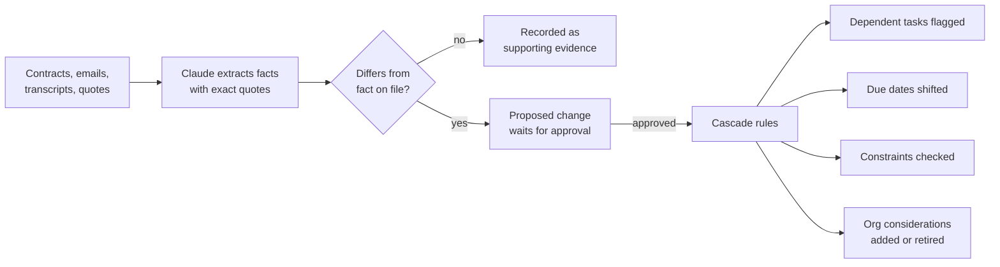

# Ripple: Event Cascade Agent

**One change in, every dependent task updated.**

🏆 **Best Technology award, Girl Develop It Hackathon (November 2026)**

> **Status: early prototype, in active development.** Ripple was built solo in three and a
> half days for the hackathon. The core pipeline works end to end on sample documents; live
> email, meeting-note and project-tool integrations are next. See [Roadmap](#roadmap).

<!-- Add a short demo GIF here, e.g.  -->

## The problem

When I ran events, the details rarely stayed put. Headcount jumped after a sales push, a
venue moved the date, valet parking disappeared. Each change lived in one email or one
meeting, and it was up to the planner to remember everything it touched: the catering
order, the seating chart, the guarantee deadline in the venue contract, the reminder
email to guests. Experienced planners carry that map in their heads. People who plan
events only occasionally don't, and that's where things fall through the cracks.

Ripple keeps that map for them.

## What it does

1. **Reads the sources a planner already gets:** contracts, emails, meeting transcripts,
   quotes and venue pages.
2. **Pulls out the event facts** (date, headcount, venue capacity, food and beverage
   minimum, deadlines and so on) and stores each one with the exact sentence it came
   from.
3. **Notices when a new source disagrees with what's on file** and proposes the change,
   with the quote as evidence. Nothing changes until a person approves it.
4. **Cascades the approved change:** every checklist task that depends on that fact is
   flagged with the reason, due dates move when the event date moves, and hard limits
   are checked (for example, 150 guests in a room that seats 120).
5. **Applies the organization's lessons learned.** Considerations, such as a snow-day
   plan from an event hit by a snowstorm, are added automatically when an event's facts
   match, and flagged as possibly unneeded when they stop matching.



## Results

Measured with `eval.py` against a hand-labeled answer key (`expected_facts.json`) and
with `test_cascade.py`:

| Measure | Result |
|---|---|
| Facts extracted correctly | **29 / 29** across 9 sample sources |
| False changes (something flagged that hadn't changed) | **0**, including a venue newsletter full of unrelated numbers |
| Quotes found word for word in their source | **39 / 39** |
| Cascade rule checks (no AI involved) | **All passing**, 32 tasks flagged end to end |

**What this does and doesn't show:** the nine sources are hand-written samples (a
contract, emails, a call transcript, a catering quote and a newsletter). They show the
pipeline works end to end. Real inboxes are messier, and the prompt was developed
against these same samples, so a larger held-out evaluation on real email is the next
step before trusting these numbers.

## Design decisions

- **AI where it's good, rules where it matters.** Claude only reads messy text and
  returns structured facts. Everything that decides what a change affects is plain,
  deterministic Python over SQLite, so the cascade is predictable and fully testable
  without calling a model.
- **Every fact carries its evidence.** Extraction must return the shortest word-for-word
  quote that proves each fact. If the quote can't be found in the document, the fact's
  confidence is lowered and it goes to a person for review.
- **A wrong fact is worse than a missing one.** First-seen facts with low confidence,
  and every change to an existing fact, wait for human approval. Repeats of a known
  value are stored as supporting evidence rather than treated as changes.
- **History is never overwritten.** A changed fact adds a new row and the old one is
  marked superseded, so Ripple can always say "changed from 100 to 150, per the planning
  call on Nov 12."
- **The organization's knowledge lives in a spreadsheet.** Fact keys, task templates
  (with the facts each task depends on) and considerations are edited in
  `Event_orchestrator.xlsx` and loaded with `seed.py`, so planners can maintain them
  without touching code.
- **Built to work offline for demos.** Extraction results are cached by source text and
  the values on file, so a rehearsed demo runs instantly without wifi or API calls.

## Current status

**Working now**
- Fact extraction with quotes, confidence scores and structured output
- Change detection, approval and rejection, including several changes at once
- Cascade to dependent tasks, due-date shifts, capacity and deadline checks
- Seasonal and fact-triggered considerations with "learned from" notes
- Corporate and personal event templates, multiple events, manual fact edits
- Review screen with incoming sources, proposed changes, flagged tasks and the full
  checklist

**Not built yet**
- Live connections to email, meeting note takers or project tools (sources are sample
  files today)
- User accounts, permissions and multi-user use
- Evaluation on real, unscripted email

## Roadmap

1. **Connect real sources.** Gmail (read-only, limited to an event label or address) and
   Zoom or another note taker feed the same pipeline, so nobody pastes anything in.
2. **Work where planners already work.** Agent-first: create and update tasks in Asana or
   another project tool behind the scenes, instead of another app to check.
3. **Learn across events.** Grow the org-wide considerations library, with the agent
   proposing new lessons learned after each event for a person to approve.
4. **Test on real, messy email.** Expand the evaluation well beyond nine samples, with a
   held-out set the prompt was never tuned on, and pilot with event planners.

## Getting started

Requires Python 3 and a [Claude API key](https://console.anthropic.com/).

```bash
git clone https://github.com/Wilder407/Ripple-event-orchestrator.git
cd Ripple-event-orchestrator
python3 -m venv .venv
source .venv/bin/activate
pip install -r requirements.txt
python init_db.py --reset
python seed.py
```

Create a file named `.env` in the project folder (it is gitignored):

```
ANTHROPIC_API_KEY=sk-ant-...
```

Then run `python app.py` and open http://localhost:8000.

## Demo walkthrough

1. **Start.** The venue contract and kickoff email (samples marked `baseline: yes`) are
   read automatically, so the event facts are already filled in.
2. On the **Updates** tab, **read** the planning call transcript. Ripple proposes
   headcount 100 → 150 and quotes the line from the call. Nothing changes yet.
3. **Approve.** Every task that depends on headcount is flagged with the reason, plus new
   items: 150 is over the venue's seated capacity of 120, and the venue needs the new
   number by the guarantee deadline.
4. Open the **Template** tab to see the same tasks highlighted in the full checklist.
5. **Read** the date-change email and approve. Due dates shift, the winter tasks are
   flagged as possibly unneeded and the spring tasks are added.

**Reset demo** puts the event back to its starting state.

## Testing

```bash
python test_cascade.py   # cascade rules on a throwaway database, no API calls
python eval.py           # extraction accuracy on the samples, writes eval_results.md
```

## Project files

| File | What it does |
|---|---|
| `Event_orchestrator.xlsx` | Fact keys, task templates and considerations. Edit, then re-run `seed.py` |
| `schema.sql`, `init_db.py`, `seed.py` | SQLite database and seeding |
| `extract.py` | Claude reads a source and returns facts with quotes |
| `cascade.py` | Fact store, change detection and cascade rules (no AI) |
| `app.py`, `static/index.html` | Review screen (standard library server) |
| `samples/` | Demo sources |
| `test_cascade.py` | Cascade checks without calling Claude |
| `eval.py`, `expected_facts.json`, `eval_results.md` | Extraction evaluation and latest results |
| `Ripple — Event Cascade Agent.pdf` | Hackathon pitch slides |

## About

Built by **Lisa Wilder**, drawing on her experience in member and event management at a life
sciences trade association, with coursework in Applied Computer Science at CU Boulder and
the Break Through Tech AI program. Feedback and ideas are welcome: open an issue.
